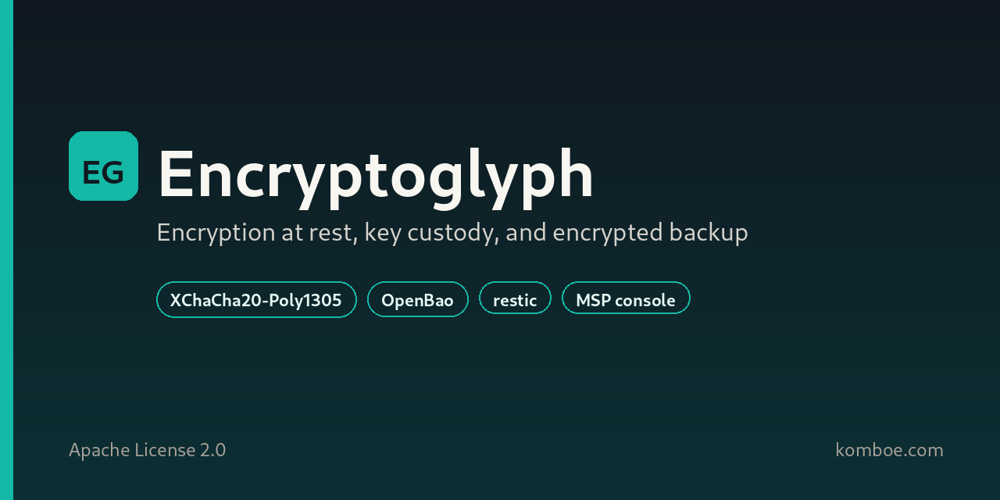
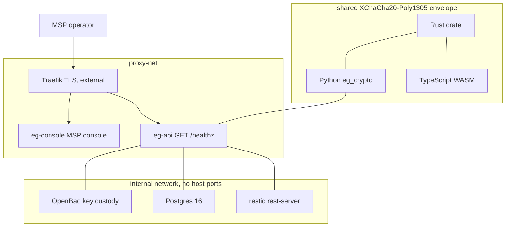
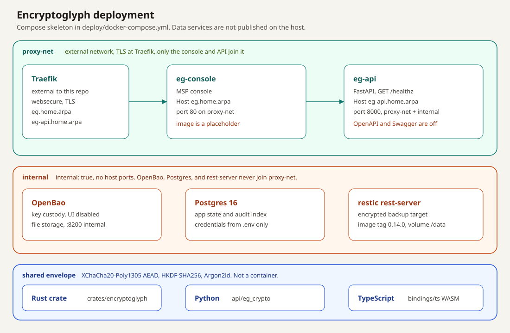

# Encryptoglyph

[](https://opensource.org/licenses/Apache-2.0)
[](https://github.com/GoDeskio/Encryptoglyph/actions/workflows/ci.yml)



Encryptoglyph is an open-source encryption-at-rest library and self-hosted service skeleton for managed service providers. It keeps field encryption, key custody, and encrypted backup in one place: an [XChaCha20-Poly1305](https://datatracker.ietf.org/doc/html/draft-irtf-cfrg-xchacha) AEAD envelope, an OpenBao custody service, a restic backup target, and an MSP console in front of them.

[Komboe](https://komboe.com) is the vault product that adopts this envelope. This repository is the shared crypto library and the deploy skeleton. It is licensed under the Apache License 2.0.

## Features

- **XChaCha20-Poly1305 AEAD.** New ciphertext uses a 192-bit nonce and a 256-bit key. The header carries a version, an algorithm id, and a key id. Legacy AES-256-GCM envelopes still decrypt, and `rewrap` upgrades them. Rust (`crates/encryptoglyph`) and Python (`api/eg_crypto`) share the wire format and the vectors in `testvectors/envelope.json`.
- **Key custody.** The compose file runs OpenBao on an internal network for Transit keys and KV. The library itself has no escrow key and no master override. Root keys are 32 bytes, derived with HKDF-SHA256 per tenant, purpose, and algorithm, or from a password with Argon2id. The health-only API does not call OpenBao yet. The custody design is in [docs/plan.md](docs/plan.md) and [docs/SECURITY-HARDENING.md](docs/SECURITY-HARDENING.md).
- **Encrypted backup.** `restic/rest-server` sits on the same internal network as the backup target. Host ports are not published. Backup scheduling and restore evidence are described in the plan and are not implemented in this tree.
- **MSP console.** Operators are meant to reach `eg-console` through Traefik at `eg.home.arpa`. The compose service is present. Its image is `encryptoglyph-console:placeholder`, and this repository does not contain a console UI.

## What this tree runs

| Piece | In this repository |
| --- | --- |
| Rust envelope, HKDF, Argon2id, key rotation | Implemented and tested |
| Python module, wire-compatible with Rust | Implemented and tested |
| TypeScript wrapper over the WASM build | Source in `bindings/ts`; `wasm-pack` output is not committed |
| `eg-api` container | `GET /healthz` only. Swagger, ReDoc, and `/openapi.json` are not served |
| OpenBao, Postgres 16, restic rest-server | Images and config in `deploy/docker-compose.yml` |
| MSP console | Service name and Traefik labels only |

## Architecture

Traefik is external. Only `eg-console` and `eg-api` join `proxy-net`. OpenBao, Postgres, and the restic rest-server stay on the `internal` network (`internal: true`), which has no route off the Docker host. The API container is the only app process that joins both networks. The crypto libraries are not containers. The API image copies `main.py` only, so the running container does not load `eg_crypto`.



The lines from `eg-api` to OpenBao, Postgres, and rest-server are placement in the compose file, not live calls from the health handler.



The SVG is the same layout: [docs/img/architecture.svg](docs/img/architecture.svg).

## Quickstart

Docker Compose is the deploy entrypoint. Secrets stay in `deploy/.env`, which is gitignored. `deploy/.env.example` lists the names and leaves the values empty.

```bash
cp deploy/.env.example deploy/.env
docker network create proxy-net
docker compose -f deploy/docker-compose.yml config
```

`proxy-net` must already exist because the compose file marks it external. `docker compose config` is the check CI runs. Do not commit `.env`.

`docker compose up` needs a local image named `encryptoglyph-console:placeholder`. That image is not published, and the console UI is not in this repository. OpenBao, Postgres, and rest-server also expect real values in `.env` before they will start.

The API image is buildable on its own. It listens on port 8000 inside the container and, in the compose file, publishes no host port. This loopback publish is only for a local health check:

```bash
docker build -t encryptoglyph-api:local -f api/Dockerfile api
docker run --rm -p 127.0.0.1:8000:8000 \
  -e BUILD_SHA="$(git rev-parse --short=12 HEAD)" \
  encryptoglyph-api:local
```

```bash
curl -sS http://127.0.0.1:8000/healthz
```

A healthy process returns `{"status":"ok","build":"<12 hex chars>"}`. `/docs`, `/redoc`, `/openapi.json`, and `/swagger` are not served. That is checked by `scripts/assert-exposure.sh`.

Without Docker, from `api/` with Python 3.12:

```bash
python -m pip install -r requirements.txt
BUILD_SHA="$(git rev-parse --short=12 HEAD)" python -m uvicorn main:app --host 127.0.0.1 --port 8000
```

## API and SDKs

The HTTP API in this repository is the health check above. Envelope encryption is the library surface, with the same record context in each language: tenant, purpose, table, record id, field, and schema version. Those fields are authenticated as additional data, so a ciphertext cannot be moved to another row, field, or tenant.

### Rust

`crates/encryptoglyph` is the source of truth. `unsafe` is forbidden. Default writes are version 2, XChaCha20-Poly1305.

```rust
use encryptoglyph::{decrypt, encrypt, Keyring, RecordContext, VERSION_V2};

fn seal_email() -> Result<Vec<u8>, encryptoglyph::Error> {
    let key = Keyring::generate_key()?;
    let kr = Keyring::new("k1", &key)?;
    let ctx = RecordContext {
        tenant: "acme".into(),
        purpose: "field".into(),
        table: "customers".into(),
        record_id: "42".into(),
        field: "email".into(),
        schema_version: 1,
    };
    let blob = encrypt(&kr, &ctx, b"ada@example.com")?;
    let plain = decrypt(&kr, &ctx, &blob, VERSION_V2)?;
    Ok(plain.to_vec())
}
```

```bash
cd crates/encryptoglyph
cargo test --locked
```

### Python

`api/eg_crypto` matches the Rust wire format. Tests run it directly. The API container image does not copy this package.

From the `api` directory:

```python
from eg_crypto import Keyring, RecordContext, encrypt, decrypt

key = Keyring.generate_key()
kr = Keyring({"k1": key}, "k1")
ctx = RecordContext(
    tenant="acme",
    purpose="field",
    table="customers",
    record_id="42",
    field="email",
)
blob = encrypt(kr, ctx, b"ada@example.com")
assert decrypt(kr, ctx, blob) == b"ada@example.com"
```

```bash
cd api
python -m pip install -r requirements-dev.txt
pytest
```

### TypeScript

`bindings/ts` is a thin wrapper around the WASM build of the Rust crate. Crypto stays in Rust. Build the package with wasm-pack, then compile the wrapper:

```bash
cd bindings/ts
npm run build:wasm
npm run build
```

```ts
import { Keyring } from "@godesk/encryptoglyph";

const key = crypto.getRandomValues(new Uint8Array(32));
const kr = new Keyring("k1", key);
const blob = kr.encrypt(
  { tenant: "acme", purpose: "field", table: "customers", recordId: "42", field: "email" },
  new TextEncoder().encode("ada@example.com"),
);
```

The package is `private` and is not published to npm from this repository. `bindings/ts/pkg` is gitignored.

## Security model

- **Authenticated encryption.** Version 2 is XChaCha20-Poly1305-IETF. The header (magic, version, algorithm, key id, nonce) is part of the additional data, together with the canonical record context. Flipping the version or moving the blob between records fails authentication.
- **Key separation.** A root key never encrypts plaintext directly. HKDF-SHA256 derives a data key from the root key, the purpose, the tenant, and the algorithm. Password root keys use Argon2id with a 16-byte salt.
- **Rotation.** A `Keyring` encrypts with the current key id and can decrypt older ids. `rewrap` writes a fresh version-2 blob. The current key cannot be retired.
- **Uniform failures.** Decrypt errors do not distinguish a bad tag from a malformed header.
- **No backdoor in the library.** There is no escrow or override key in the Rust or Python code. Custody of root keys is an OpenBao operation, still outside the health-only API.
- **Network.** Compose does not publish host ports. OpenBao's own UI is disabled. Postgres passwords come from the gitignored env file.
- **Dependency licenses.** `cargo deny` allows Apache-2.0, MIT, BSD, ISC, MPL-2.0, Unicode, Zlib, and CC0. The check runs in CI.

Report vulnerabilities to security@komboe.com. The process is in [SECURITY.md](SECURITY.md). Hardening notes and the Komboe adoption plan are in [docs/SECURITY-HARDENING.md](docs/SECURITY-HARDENING.md) and [docs/design/komboe-integration.md](docs/design/komboe-integration.md).

## License

Encryptoglyph is open source under the [Apache License, Version 2.0](https://www.apache.org/licenses/LICENSE-2.0). See [LICENSE](LICENSE) and [NOTICE](NOTICE). Copyright 2026 GoDesk.

Third-party components stay under their own licenses. See [THIRD_PARTY_NOTICES.md](THIRD_PARTY_NOTICES.md).

Contributions are licensed under Apache-2.0. Read [CONTRIBUTING.md](CONTRIBUTING.md) and the [Contributor Covenant](CODE_OF_CONDUCT.md) before opening a pull request.

## Project links

- [Komboe](https://komboe.com)
- [Security policy](SECURITY.md)
- [Contributing](CONTRIBUTING.md)
- [Code of conduct](CODE_OF_CONDUCT.md)
- [Product plan](docs/plan.md)
